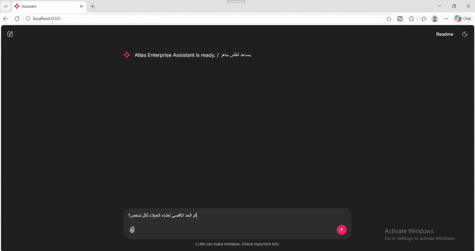

# Atlas Industries Enterprise Assistant

An internal, agentic RAG chatbot that answers employee questions about **HR**, **IT**, and **Finance** policies from Atlas Industries' own documents. It works in **English and Arabic**, cites the source files it used, remembers the conversation within a session, and can call small typed tools (policy lookup, reimbursement calculator, leave types). Every run is logged with a `run_id`, and the pipeline is evaluated with DeepEval.

> Atlas Industries is a fictional company. This is the graduation project of the AI & Machine Learning Boot Camp (Atlas Industries, Agentic Internal Knowledge Chatbot).

## Demo



| English question with sources | Arabic question (RTL) |
|---|---|
|  |  |

## Quick Start (5 commands)

```bash
git clone https://github.com/Mariam-abd-elhady/atlas-enterprise-assistant.git && cd atlas-enterprise-assistant
python -m venv .venv && source .venv/bin/activate        # Windows: .venv\Scripts\activate
pip install -r requirements.txt
cp .env.example .env                                     # then set GOOGLE_API_KEY inside .env
python -m src.ingest && chainlit run app.py
```

The first ingestion downloads the embedding model, so it can take a few minutes. The vector index is written to `index/` and is not committed; run `python -m scripts.reset` to wipe and rebuild it. On Windows, use the repository files directly instead of unzipping `atlas-corpus.zip`, to avoid problems with Arabic filenames.

## How it works

1. **Ingestion** reads the 30 documents (Markdown, PDF, DOCX; English, Arabic, bilingual), cleans them, splits them into chunks, embeds them with a multilingual model, and stores them in Chroma with `domain`, `source_filename`, and `language` metadata.
2. **LangGraph workflow:** `load_memory -> route -> retrieve -> agent -> answer -> save_memory`. The router picks `hr`, `it`, or `finance`; below a confidence threshold the assistant asks the user to clarify instead of guessing. The agent (Gemini) can call up to 3 typed tools within a 10-step limit.
3. **Answer** is written in the user's language and ends with the real source filenames; if nothing relevant is found it says so.


## Tech stack

| Part | Choice |
|---|---|
| Orchestration | LangGraph / LangChain |
| LLM | Gemini (`LLM_MODEL` in `src/settings.py`) |
| Embeddings | `intfloat/multilingual-e5-small` (English and Arabic) |
| Vector store | Chroma (local, persisted) |
| UI | Chainlit |
| Validation | Pydantic |
| Evaluation | DeepEval, Gemini as judge |

Models can be overridden without editing code: `LLM_MODEL=<model> JUDGE_MODEL=<model> python -m tests.evaluate`.

## Evaluation results

`python -m tests.evaluate` runs the 10 gold questions through the real workflow and writes `outputs/eval_report.json`. Latest run (`gemini-3.1-flash-lite` as assistant and judge; the default model hit its free-tier quota):

| Metric | Score |
|---|---|
| Routing accuracy | 100% (10 of 10) |
| Citation recall (expected files cited) | 95% |
| Faithfulness | 0.93 |
| Answer Relevancy | 0.93 |
| Hallucination (1 = none) | 1.00 |
| Contextual Precision | 0.82 |
| Contextual Recall | 0.82 |

A first run, before the router handled Arabic and several English terms, scored 40% routing accuracy. The scores above compare answers with the *retrieved context*; a manual check against the reference answers also found wrong or missing figures in two answers (hotel and taxi caps, international per diem) because retrieval did not bring the right passage. Details are in [`outputs/final_report.md`](outputs/final_report.md) and `notebooks/03_eval_walkthrough.ipynb`.

```bash
python -m tests.evaluate                  # full run
python -m tests.evaluate --limit 2        # quick test on 2 cases
python -m tests.evaluate --skip-metrics   # routing + citations only (no judge calls)
```

## Project structure

```
atlas-enterprise-assistant/
├── README.md
├── LICENSE
├── requirements.txt
├── .env.example
├── .gitignore
├── app.py                    # Chainlit chat UI
├── CONTRACT.md               # work split and shared rules
├── src/
│   ├── settings.py           # paths, model names, thresholds
│   ├── schemas.py            # shared types (Chunk, ToolCall, AgentState)
│   ├── ingest.py             # load, clean, chunk, embed, index
│   ├── embeddings.py
│   ├── retriever.py          # domain-filtered retrieval
│   ├── router.py             # question -> domain + confidence
│   ├── graph.py              # LangGraph workflow, run_question()
│   ├── memory.py             # session memory
│   ├── prompts.py
│   ├── tools.py              # typed tools
│   └── logging_setup.py      # run_id and structured logs
├── tests/
│   ├── evaluate.py           # DeepEval evaluation
│   └── eval_cases.jsonl      # 10 gold questions
├── data/docs/{hr,it,finance}/  # 30 fictional documents
├── outputs/
│   ├── eval_report.json
│   ├── run_logs.jsonl
│   └── final_report.md
├── notebooks/                # 01 EDA, 02 retrieval, 03 eval walkthrough
├── docs/                     # architecture.png, demo.gif, screenshots
└── scripts/reset.py          # wipe and rebuild the index
```

## Code quality

Format and lint before committing: `black .` and `ruff check .`. Settings live in `src/settings.py`; secrets live in `.env` (only `.env.example` is committed).

## Known limitations

- The router is keyword based (English and Arabic lists); a question without a known keyword cannot be routed, and the keyword lists partly overlap the evaluation questions, so the 100% routing score may be optimistic.
- Retrieval can miss the passage that holds a specific figure (hotel and taxi caps, international per diem), and DeepEval scores cannot detect a wrong answer built on the wrong chunks.
- Only 10 evaluation cases, and the same model family acted as assistant and judge, so scores are indicative, not statistically strong.
- The free-tier Gemini quota limits how often the full evaluation can be run.
- The tools were not triggered by any of the 10 gold questions, so tool use is not covered by the evaluation.

## License

MIT, see [`LICENSE`](LICENSE).
